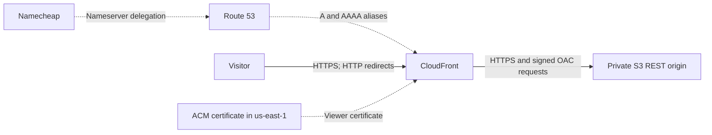

# GBM Cloud

**CSCE 412 Project 5 | Sai Abhinav Vurakaranam | Texas A&M University**

- Website: <https://csce412abhivur.me/>
- Private repository: <https://github.com/abhivur/CSCE412-Project5>
- Runtime model: OpenAI `gpt-4.1-mini`, configurable through `OPENAI_MODEL`.

GBM Cloud is a five-page cloud-learning website and a custom Python multi-agent
system for secure deployment, verification, and failure recovery. The website
uses a maroon-and-white identity, cloud illustrations, solution filters, and a
launch planner with local persistence, progress tracking, reset, and text download.
It runs entirely in the browser without a continuously running backend.

The deployment uses **S3, CloudFront, Route 53, and ACM**, with domain registration
through Namecheap. Runtime agents use the OpenAI Responses API through Python's
standard library. The Python module remains named `cloudcrew` for compatibility
with the deployed system and historical execution records.

## Architecture



S3 blocks public access. CloudFront Origin Access Control (OAC) signs origin
requests with SigV4. The bucket policy limits reads to the project's distribution.
ACM supplies the custom-domain certificate. CloudFront redirects HTTP to HTTPS
and serves a custom error document with a real HTTP 404 status.

The five canonical pages are Home (`index.html`), Solutions (`solutions.html`),
Resources (`resources.html`), About (`about.html`), and Launch planner
(`planner.html`). Complete HTML templates and generation logic are in
[`cloudcrew/site.py`](cloudcrew/site.py). Editable text is in
[`website/content.json`](website/content.json); CSS, JavaScript, and SVG assets
are in [`website/assets/`](website/assets/). Building generates all five pages,
the custom 404 page, and three compatibility pages in ignored `dist/`.

See the [architecture diagrams](docs/architecture.md) and
[deployment and recovery runbook](docs/runbook.md) for details.

## Five executable agents

Each role has separate instructions and a restricted tool allowlist in
[`cloudcrew/agents.py`](cloudcrew/agents.py).

| Agent | Responsibility | Representative tools |
| --- | --- | --- |
| Planner | Inspect requirements and assign structured tasks | `inspect_project` |
| Website | Revise bounded introductions, build, and check the site | `update_page_intro`, `build_site`, `check_site` |
| Infrastructure | Inspect AWS, prepare changes, request approved execution | `inspect_infrastructure`, `prepare_plan`, `apply_plan` |
| Verification | Measure local or live behavior and security | `check_site`, `verify_deployment`, `diagnose_dns` |
| Diagnosis | Analyze failures and prepare or apply approved restoration | `inspect_infrastructure`, `prepare_plan`, `apply_plan` |

The orchestrator passes messages containing `sender`, `recipient`, `message_id`,
`task`, `context`, and `upstream` results. Models interpret tasks, select tools,
and explain observations. Deterministic Python validates arguments, generates
configurations and HTML, executes trusted tools, enforces approval, and evaluates
measured checks. It does not execute model-generated shell text.

[`cloudcrew/llm.py`](cloudcrew/llm.py) implements Responses API function calling,
strict tool schemas, argument validation, and structured `finish` results.
Observations return to the model using their function-call IDs. Defaults limit
each agent invocation to eight model calls and each response to 2,200 output
tokens. There is no simulated-agent execution mode. Tests inject fixtures
separately from actual runtime execution.

## Dependencies and setup

Run commands from the repository root. Required tools are:

- **Python 3.10 or later.** The application uses only the standard library. No
  `pip install` or Python requirements file is needed to run from this checkout.
- **AWS CLI v2** for live cloud inspection, deployment, and recovery. Local
  builds, local agent workflows, and unit tests need no AWS authentication.
- **Node.js 18 or later** for JavaScript tests. No npm packages are required.
- An **OpenAI API key** with access to a Responses-compatible function-calling
  model for actual agents. Deterministic build/check/tests need no API key.
- **Tectonic**, only if rebuilding the optional LaTeX technical report.

The development environment used Python 3.14.7, AWS CLI 2.36.38, and Node.js
25.9.0. On the development Mac, `/opt/homebrew/bin/python3` is the supported
interpreter; system Python is too old. Substitute that path below if necessary.

```bash
python3 --version
python3 -m cloudcrew init
```

`init` copies the supplied templates to `.env` and `config/project.json`, without
overwriting existing settings. Edit `.env` locally:

```dotenv
OPENAI_API_KEY=YOUR_OWN_API_KEY
OPENAI_MODEL=gpt-4.1-mini
AWS_PROFILE=default
```

The key above is a placeholder. Shell environment variables take precedence over
`.env`. `OPENAI_MODEL` and `AWS_PROFILE` override the corresponding JSON settings.
Select a model available to the API account. Agent calls can incur API charges.

For cloud work, edit `config/project.json` with a real lowercase domain, unique
bucket name, project ID, region, and authenticated profile. The example contains
deliberately invalid deployment placeholders to prevent accidental writes. Use
`us-east-1` for the CloudFront viewer certificate. Keep AWS credentials in the
CLI credential chain, outside JSON and source files.

The original deployment's local configuration, state, credentials, and raw logs
are excluded from this checkout. A fresh clone can build and test the source
but cannot take over the existing distribution without its matching original
configuration and saved state. Continue live administration in the original
deployment workspace, or restore those files locally from a trusted private
backup. Do not use a fresh foundation run to take over existing resources.

## Build and preview without API calls or AWS writes

```bash
python3 -m cloudcrew doctor
python3 -m cloudcrew build
python3 -m cloudcrew check
python3 scripts/preview.py
```

Expected result: the build writes `dist/`, and the static check passes for nine
HTML files. Open <http://127.0.0.1:8765/> to use the website. The preview serves
only the build and an explicit QA harness, so it does not expose credentials or
source. Stop with Ctrl+C.

## Reproduce a representative real agent workflow

After setup and API-key configuration, run:

```bash
python3 -m cloudcrew agents --mode local
```

This invokes actual models and executable tools in sequence:

1. The planner inspects the project and assigns website, infrastructure, and
   verification tasks.
2. The website agent can revise introductions, builds the site, and checks links
   and assets. Review any source text it changes.
3. The infrastructure agent records an architecture specification. Local mode
   does not contact AWS or create infrastructure.
4. The verification agent checks the build and returns measured findings. A
   blocked result triggers diagnosis with the upstream evidence.

The command prints its actual run directory under `runtime/runs/`. Inspect its
`events.jsonl` and role-result JSON files for handoffs, model response IDs, tool
calls, observations, and completion status. Missing credentials or API access
produce errors instead of fabricated success. Local success does not establish
live deployment or recovery.

## Deployment, verification, and controlled recovery

Follow the [full runbook](docs/runbook.md) and [IAM guidance](infra/README.md).
Register and delegate the domain, authenticate the correct AWS account, and
review project-scoped permissions before cloud execution. The application does
not attach IAM policies or audit all effective account permissions.

Deployment stages run in order: `foundation`, `certificate-dns`, then `delivery`.
For each stage, use the agent-assisted command:

```bash
python3 -m cloudcrew agents --mode deploy \
  --stage foundation --interactive-approvals
```

Repeat with `certificate-dns` and `delivery` after each stage's prerequisites are
ready. The runbook explains certificate validation and registrar delegation.
Cloud writes require the human to approve the exact displayed plan digest.
Stale plans, changed source/state, mismatched ownership tags, and stale
CloudFront ETags are rejected.

After deployment, wait for readiness and request actual verification:

```bash
python3 -m cloudcrew wait
python3 -m cloudcrew agents --mode verify
```

`python3 -m cloudcrew verify` runs deterministic live checks without an LLM.
`python3 -m cloudcrew dns` diagnoses resolver differences without changing DNS.
Later website changes use the `publish` deployment stage.

With a passing baseline and the matching deployment state, reproduce the complete
failure and recovery workflow using:

```bash
python3 -m cloudcrew exercise
```

The command verifies the baseline, requests approval to set CloudFront's default
document to a confirmed missing key, waits, measures root HTTP 404 versus explicit
`/index.html` HTTP 200, invokes diagnosis, requests approval to restore the saved
configuration, waits, and independently verifies recovery. It temporarily affects
the real website. Keep the terminal open until restoration is verified. If
interrupted, use the recorded recovery path in the runbook.

The completed experiment, run `20261109T032929-cece25c9`, passed 23/23 checks before
the fault, observed 21/23 passing during the intentional failure, and passed
23/23 after approved restoration. These are historical measurements, not a
guarantee about future runs. Detailed actual logs are submitted separately in
`project5-agent-logs.zip`, rather than committed as test fixtures.

## Tests

```bash
python3 -m unittest discover -s tests -v
node --test tests/*.test.cjs
node --check website/assets/app.js
```

The current suite has 56 Python tests and 12 JavaScript tests. It covers schemas,
tool allowlists, approvals and stale plans, recovery evidence, expected-failure
observation, links, escaping, planner state and downloads, filtering, and mobile
navigation. Tests use isolated fixtures and make no live AWS changes or billable
model calls. With the preview running, open
<http://127.0.0.1:8765/__qa__/browser.html> for the actual-page browser harness.

## Repository contents and submission

| Path | Contents |
| --- | --- |
| `cloudcrew/` | Executable agents, API integration, tools, CLI, audit and validation logic |
| `website/` | Editable content, CSS, JavaScript, and original SVG assets |
| `config/*.example.json`, `.env.example` | Configuration and environment templates |
| `infra/` | IAM template and administrative guidance |
| `scripts/` | Local preview and optional LaTeX report build |
| `tests/` | Python/JavaScript tests and browser harness |
| `docs/` | Architecture, runbook, demo guidance, and report LaTeX source |
| `pyproject.toml` | Python metadata, supported version, optional CLI entry points |

Private settings, populated `.env`, generated `dist/`, runtime state and logs,
submission archives, caches, and credentials are ignored. Instructor handouts
and the introductory tutorial are not runtime dependencies and are excluded.

For the **Agent Code GitHub Link** assignment, submit this URL in Canvas:

<https://github.com/abhivur/CSCE412-Project5>

Keep the repository **private**, add the designated TA/instructor GitHub accounts
as collaborators, and confirm they can view the final committed and pushed code.
An inaccessible URL is not sufficient. The technical report, agent logs, and demo
are separate submissions.

## AI use and references

OpenAI Codex assisted with implementation, design and rebranding, SVG assets,
tests, troubleshooting, and documentation. Runtime agents use OpenAI Responses
function calling through the custom orchestrator. Human actions include account
authentication, domain registration/delegation, terminal execution, and exact-plan
approval. Coding-assistant work is distinct from recorded runtime agent calls.

- [AWS: S3 origin access control](https://docs.aws.amazon.com/AmazonCloudFront/latest/DeveloperGuide/private-content-restricting-access-to-s3.html)
- [AWS: CloudFront certificate requirements](https://docs.aws.amazon.com/AmazonCloudFront/latest/DeveloperGuide/cnames-and-https-requirements.html)
- [AWS: Custom error responses](https://docs.aws.amazon.com/AmazonCloudFront/latest/DeveloperGuide/custom-error-pages-procedure.html)
- [OpenAI: Function calling](https://developers.openai.com/api/docs/guides/function-calling)
