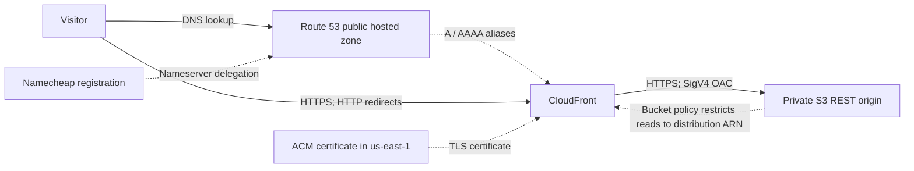
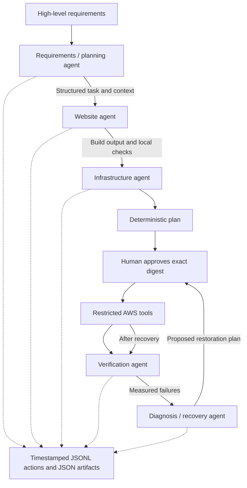

# Cloud and agent architecture

S3 website hosting is deliberately not enabled: OAC requires the regular S3 origin.
The bucket blocks all public access, enforces bucket ownership, and uses S3-managed
AES256 encryption. CloudFront maps missing-object 403/404 responses to a custom
404 page while preserving a 404 response code. This is a multipage website, not
an SPA fallback that returns 200 for missing pages.

The custom orchestrator calls specialized LLM-backed agents sequentially. The
planner generates role-specific tasks, passed with upstream structured results.
The model selects allowed function tools; Python validates tool arguments,
executes trusted functions, and returns observations to the model. The model
does not generate executable shell text. A `finish` function provides a structured
decision. Agent call limits and token limits bound API usage; usage is logged.

| Agent | Inputs | Tools | Outputs |
| --- | --- | --- | --- |
| Planner | Requirements, config, source inventory | Inspect project | Task decomposition and constraints |
| Website | Planner task and source | Inspect, update plain-text introductions, build, check | HTML/assets, content changes, local findings |
| Infrastructure | Requirements, website result, deployment stage | Architecture, AWS read inspection, prepare/apply plan | Reproducible configuration and deployment observations |
| Verification | Uploaded manifest, domain, resource IDs | Local checks, anonymous HTTP/TLS, AWS configuration reads | Measured pass/fail evidence |
| Diagnosis | Verification failures and current AWS state | Inspect, verify, prepare recovery, approved apply | Root-cause assessment and corrective plan |

The LLM interprets requirements, selects tools, and explains observations. Python
deterministically renders HTML, constructs AWS configurations, scopes operations,
executes approved actions, computes hashes, and evaluates checks. These are
different responsibilities and should be distinguished in the demonstration.

The five agents are independent role definitions in one executable system, not
five separate background servers or manually copied chatbot conversations.
