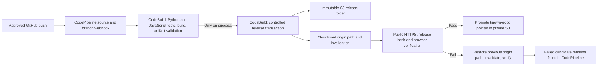

# Project 6 setup and operations

GBM Cloud extends the Project 5 website and agent system with automatic releases.
The deployment branch is `main` in the private `abhivur/CSCE412-Project5`
repository. Source code, tests, buildspecs, configuration generation, release
control, production verification, and recovery are all in this checkout.

## Architecture



There are three CodePipeline stages: Source, BuildAndValidate, and Release. The
Release CodeBuild job implements deployment, content delivery, production
verification, and failure handling in one compensating transaction. This keeps
rollback available when any step after activation fails. The six required logical
steps are all executable and logged; failure handling does not depend on a later
pipeline stage that could be skipped after an earlier error.

Two CloudFront origins point to the same private S3 REST endpoint. The default
origin's `OriginPath` selects `/releases/<release-id>`. A `releases/*` behavior
uses a second root-path origin to serve immutable, versioned assets. Each HTML
page references its own release's assets. During propagation, cached older HTML
therefore continues to use matching older assets. A complete rollback changes the
default origin back to the saved release and invalidates the cache. No single-file
repair, manual old-folder upload, public S3 hosting, or deletion is required.

Private pipeline artifacts, manifests, state, and evidence use a separate bucket
from the public website content. Releases are immutable, and promotion occurs only
after actual production checks pass. Conditional S3 state writes and QUEUED
executions prevent concurrent writers. Interrupted operations leave a durable
recovery record instead of guessing that a timed-out operation succeeded.

## Dependencies

- Python 3.10 or newer locally. CodeBuild uses Python 3.12.
- Node.js 18 or newer for local tests. CodeBuild explicitly uses Node.js 22.
- AWS CLI v2. Local commands can use `--profile default`; CodeBuild uses its
  scoped service role and does not receive a local profile or long-lived key.
- The pinned Playwright dependency and Chromium for actual browser verification.
- An OpenAI API key only for optional agent engineering or diagnosis commands.
  Build, deploy, verification, and automatic rollback do not call an LLM.

From this repository root:

```bash
python3 -m venv .venv
source .venv/bin/activate
python3 -m pip install -r requirements-ci.txt
python3 -m playwright install chromium
python3 -m cloudcrew init
```

On the development Mac, use `/opt/homebrew/bin/python3` to create the virtual
environment if system Python is too old. Linux browser installation can use
`python3 -m playwright install --with-deps chromium`, as the release buildspec
does. Plain builds and unit tests need no extra Python packages.

## Configuration and secrets

`config/cicd.production.json` contains the existing website's nonsecret resource
identifiers. Review its account, buckets, distribution, domain, repository, and
branch before setup. For another deployment, edit a copy of
`config/cicd.example.json` and pass it using the global `--config` option. The
existing Project 5 ownership binding must match its original resource tags.

CodeBuild receives the approved public configuration as `GBM_SETTINGS_JSON`,
rather than trusting a later commit to repoint its resources. IAM also limits
its actual permissions to this project's resources. `GBM_SOURCE_COMMIT`,
`GBM_EXECUTION_ID`, and the CodeBuild resolved revision must agree before
unattended deployment is allowed.

Set optional local secrets in ignored `.env`, never in JSON or source:

- `OPENAI_API_KEY`: needed for real agent API calls only.
- `OPENAI_MODEL`: defaults to `gpt-4.1-mini` through the existing configuration.
- `AWS_PROFILE`: optional named local CLI profile.
- `GITHUB_SOURCE_TOKEN`: used only during GitHub OAuth source setup. It is never
  passed to CodeBuild or the model.

The default source uses the documented GitHub OAuth action and a branch-specific
HMAC webhook, avoiding a new CodeConnections service resource outside the listed
services. AWS recommends the newer GitHub App connection for general deployments;
the optional `connection` provider here requires an existing ARN and explicit
`connection_approved: true` after instructor approval. The OAuth token needs
`repo` and `admin:repo_hook` scopes. Use a dedicated token and load it locally.
Webhook secrets are generated independently during setup, not reused from a
credential. Do not paste tokens into command arguments, chat, screenshots, or
commits.

CloudWatch logging is disabled; CodeBuild logs go to private S3. No Lambda,
CloudFormation, Secrets Manager, EventBridge rule, or custom KMS key is deployed.
IAM service roles and AWS-managed artifact encryption are supporting AWS
mechanisms for CodePipeline/CodeBuild. Encryption permissions are limited to this
account's artifact bucket through S3. The code does not provision a KMS service
resource or invoke KMS directly.

## One-time setup

Do this after reviewing and pushing the implementation. Keep the website's
existing S3 bucket, CloudFront distribution, DNS, certificate, and ownership tags.

### 1. Review the exact infrastructure plan

```bash
python3 -m cloudcrew.cicd pipeline-plan
```

The command writes actual CodePipeline/CodeBuild requests, IAM policies and trust
policies, and a webhook template under `runtime/project6/pipeline/`. Their
generator is committed in `cloudcrew/pipeline_config.py`; no console screenshot
is needed to reconstruct the configuration. Templates contain placeholders, not
tokens. Regenerate a plan if configuration or buildspecs change.

### 2. Create the private artifact bucket and restricted roles/build projects

```bash
python3 -m cloudcrew.cicd --profile default pipeline-apply \
  --plan runtime/project6/pipeline/pipeline-plan.json --infrastructure-only
```

Review the displayed scope and type its exact approval phrase. This administrator
step creates three scoped roles and two build projects. It refuses to modify
unowned resources and does not grant IAM administration to pipeline jobs. The
validation role cannot write website content or change CloudFront. The release
role can write only release folders and private control/evidence objects and can
update only the existing distribution. No deletion permissions are granted.

The setup operator needs permission to create/configure the named artifact bucket,
create/read/tag the three project IAM roles and their inline/trust policies,
pass those roles to CodeBuild/CodePipeline, create/update the two named build
projects and pipeline, and register its GitHub webhook. Adoption additionally
needs reads of the existing website, writes to its `releases/` prefix, and
configuration/invalidation access to the existing distribution. These are
administrator setup permissions, not privileges given to normal validation jobs.
The generated `*-policy.json` files show the exact runtime service-role actions
and resource ARNs. Use an authorized administrator or permission boundary that
permits these scoped setup operations.

### 3. Adopt a verified baseline

The original Project 5 workspace contains its publication manifest and recovery
state. Restore any active Project 5 exercise and obtain a healthy website first.
From the repository folder, the existing state path is `../runtime/state.json`.

```bash
python3 -m cloudcrew.cicd --profile default adopt \
  --project5-state ../runtime/state.json
```

This command checks the ownership binding and actual existing bytes, verifies the
legacy website and planner, and displays the migration for approval. It archives
the existing site as `bootstrap-<content-digest>`, adds release identity and
versioned asset links, configures the asset origin, switches the default origin,
waits for propagation/invalidation, and verifies the new baseline. Only then does
it establish the known-good pointer. The imported baseline honestly records a
snapshot ID with no invented source commit. All later source releases use full
commit hashes. A failed adoption restores and verifies the saved original layout;
an interrupted adoption can use the same bounded recovery command.

After adoption, use Project 6 release commands for this website. The Project 5
configuration-restoration exercise is historical and is not a release rollback.

### 4. Authorize GitHub and enable the pipeline

Save `GITHUB_SOURCE_TOKEN` in local `.env` if using OAuth, then run:

```bash
python3 -m cloudcrew.cicd --profile default pipeline-apply \
  --plan runtime/project6/pipeline/pipeline-plan.json
```

The exact plan must be approved. The setup installs the branch-specific webhook
and disables polling to avoid duplicate triggers. A fresh push to `main` then
starts the pipeline without a manual S3 upload. GitHub authorization remains a
human account action. Keep the repository private and give graders access.

## Local validation

```bash
python3 -m unittest discover -s tests -v
node --test tests/*.test.cjs
python3 -m cloudcrew.cicd validate
```

The last command builds and tests actual website artifacts, writes a machine-readable
`out/validation-report.json`, and packages `out/release/`. HTML structure, page
navigation, links/fragments, assets, source identity, secret patterns, paths,
symlinks, file sizes, and hashes are checked. A local package is a preview of the
working tree, not evidence of a committed or deployed release. The pipeline repeats
these checks against the GitHub source revision and validates the revision again
before deployment. A failed gate exits nonzero and blocks the Release stage.

`ci/buildspec-validate.yml` and `ci/buildspec-release.yml` are JSON-form YAML,
which CodeBuild accepts. The build phase aborts on failure. Its `finally` block
persists evidence even after a rejected gate or a rolled-back release. The release
job installs the browser before activation; an installation failure cannot publish
a candidate. It consumes the tested artifact and does not rebuild it.

## Production and recovery commands

```bash
python3 -m cloudcrew.cicd --profile default status
python3 -m cloudcrew.cicd --profile default verify
python3 -m cloudcrew.cicd --profile default recover
```

Verification checks the actual public release identifier, all release files and
hashes, root CloudFront delivery, TLS and hostname, HTTP redirect, private S3,
bucket policy, active origin path, and OAC signing. A real Chromium browser submits
the planner form, checks a task, reloads persistence, downloads the checklist, and
resets it. HTTP 200 alone does not establish a working feature. Browser errors or
an unavailable required browser cause failure rather than a skipped success.

Normal rollback is automatic and bounded: only the recorded previous complete
release is eligible. Its archived bytes are checked before use. Restoration is
independently verified, and the failed candidate leaves CodePipeline failed even
when the website has recovered. A failed rollback leaves `inflight` state for
operator recovery. The manual `recover` command asks for approval, refuses stale
state and unrelated CloudFront changes, and restores only the recorded target.
There is no expiring lease that could silently permit two writers.

## Actual agent workflows

The original five roles remain in the code. Five specialized Project 6 roles
reuse the same model transport, schema validation, audit format, and tool loop:

| Role | Actual work and allowed tools |
| --- | --- |
| Pipeline engineer | Inspects configuration, renders real pipeline/role requests, validates buildspecs |
| Test engineer | Executes Python/JavaScript tests and validates generated website/release artifacts |
| Release verifier | Reads release state and runs actual public/browser/security checks |
| Release diagnosis | Retrieves actual CodePipeline execution, CodeBuild phase results, and retained reports |
| Recovery coordinator | Identifies the known-good target, prepares only its recorded restoration, requests human approval for interrupted recovery |

```bash
python3 -m cloudcrew.cicd agents --mode engineer
python3 -m cloudcrew.cicd --profile default agents --mode verify
python3 -m cloudcrew.cicd --profile default agents --mode diagnose --execution ACTUAL_EXECUTION_ID
python3 -m cloudcrew.cicd --profile default agents --mode recover \
  --execution ACTUAL_EXECUTION_ID --interactive-approvals
```

Use the actual ID from CodePipeline; the placeholder is not executable evidence.
To reuse the original workspace's local model key without copying it, the global
`--env-file ../.env` option can be supplied before `agents`. Agent decisions and
tool results are logged under `runtime/runs/`. Handoffs contain sender, recipient,
message ID, task, context, and upstream results. Diagnosis must cite the affected
commit/stage, observed failure, and actual supporting evidence. Prepared changes
are not reported as applied changes. The agents cannot issue arbitrary shell or
administrator operations. Optional AI recovery of an interrupted deployment needs
the exact human approval; ordinary predetermined pipeline rollback needs no LLM.

## Retained evidence

Private S3 stores `control/production.json`, immutable release manifests, per-build
evidence folders, and stage index JSON files. The bucket has versioning enabled.
CodeBuild S3 logs and actual pipeline execution metadata supplement test reports.
Browser verification saves genuine success/failure screenshots under `out/browser/`;
the job retains them in private S3 and the evidence ZIP. These are actual browser
captures, not generated illustrations or manually written output.
Inspect the current release publicly at `https://csce412abhivur.me/release.json`
after adoption.

Export one real execution and an optional linked real diagnosis run:

```bash
python3 -m cloudcrew.cicd --profile default evidence \
  --execution ACTUAL_EXECUTION_ID --agent-run ACTUAL_AGENT_RUN_ID
```

Repeat for the three experiments. The exporter rejects unit fixtures and agent
runs unrelated to that execution. It includes actual machine records, redacted
build logs, and a SHA-256 manifest in an ignored submission ZIP. A rolled-back or
failed run retains that status; missing experiments are not invented.

## References

- [GitHub OAuth source and webhook](https://docs.aws.amazon.com/codepipeline/latest/userguide/appendix-github-oauth.html)
- [CodeBuild actions and multiple artifacts](https://docs.aws.amazon.com/codepipeline/latest/userguide/action-reference-CodeBuild.html)
- [CodeBuild runtime versions](https://docs.aws.amazon.com/codebuild/latest/userguide/available-runtimes.html)
- [CodeBuild service-role scope](https://docs.aws.amazon.com/codebuild/latest/userguide/setting-up-service-role.html)
- [CodePipeline execution modes](https://docs.aws.amazon.com/codepipeline/latest/userguide/execution-modes.html)
- [Conditional S3 writes](https://docs.aws.amazon.com/AmazonS3/latest/API/API_PutObject.html)
- [CodeBuild S3 logging](https://docs.aws.amazon.com/codebuild/latest/APIReference/API_LogsConfig.html)
